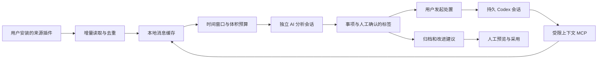

# 架构与设计思路

## 目标与取舍

拾事把“收集消息”“判断事项”“执行调查”分成独立环节。消息是证据，不是操作授权；分类分析不直接执行事项，正式处置由用户发起。

选择 Rust 管理文件、并发和进程生命周期；使用 WebView2 展示本地 HTML/CSS/JavaScript，使桌面界面保持轻量。应用不需要部署常驻 HTTP 后端。消息来源通过 C ABI 插件扩展，主程序不耦合具体通讯软件。

## 数据流

## 模块

| 位置 | 职责 |
| --- | --- |
| `src/main.rs`、`assets/ui/`、`src/ui_bundle.rs` | 本地 WebView、IPC 路由；界面按 `assets/ui/manifest.txt` 顺序把样式（token/布局/设计层）和按页面拆分的脚本组装成单一页面，构建期嵌入，开发时可用 `--ui-dir` 从磁盘加载 |
| `src/engine.rs`、`src/model.rs` | 应用状态、事务式保存、任务和配置模型 |
| `src/sources.rs`、`src/plugins.rs` | 来源管理、增量游标、插件包检查及 DLL 调用 |
| `src/ai.rs`、`src/ai_backend/` | 请求构造、输出 schema、AI 驱动适配 |
| `src/ai_backend/api.rs`、`providers/api/` | OpenAI Chat Completions 兼容分析、WinHTTP、严格 schema、多模态工具循环和模型发现 |
| `src/ai_backend/dsh.rs`、`providers/acp/` | DeepSeek Harness 桌面 ACP 分析/处置、受限工具集、提交校验和模拟协议测试 |
| `src/credentials.rs` | DPAPI 本地密钥或指定环境变量二选一，不把密钥写入配置、状态或日志 |
| `config/prompts.json`、`src/prompt_config.rs` | 提示词资源、受校验的本地策略覆盖 |
| `src/context_budget.rs`、`src/analysis_context.rs` | 输入预算、消息截断、摘要、只读按需补查 |
| `src/snapshots.rs` | 消息/事项/更新流水的可重建只读快照及校验 |
| `src/handling.rs`、`src/codex_bridge.rs` | 持久处置、追问、审批与会话同步 |
| `src/context_mcp.rs`、`src/images.rs` | 当前事项授权范围、消息和图片上下文 |
| `src/holiday.rs`、`src/work_state.rs`、`src/work_scheduler.rs`、`src/calendar_service.rs` | 日历缓存/校正、业务日、加班、上下班边界和归档排队 |
| `src/message_filter.rs`、`src/task_steps.rs` | 第四用途消息过滤（只决定提前分析）和事项步骤/依赖/人工确认 |
| `src/tags.rs`、`src/prompts.rs`、`src/archive.rs` | 标签、提示词版本、增量归档 |
| `plugin-sdk/`、`examples/json-source/` | 稳定边界的插件 SDK 和通用 JSON 来源示例 |

## 技术栈

Rust 2021；serde/serde_json 处理结构化数据；chrono 处理时刻；UUID 标识对象；fs2 提供实例锁；windows-sys 提供 Windows API；tao 管理窗口事件；wry/WebView2 渲染本地页面；rfd 提供文件选择；NSIS 生成用户级安装器；Playwright 运行模拟 IPC 的无头 UI 回归。

`vendor/wry` 是随源码分发的本地补丁版本，通过 Cargo patch 使用。它的许可证独立保留，升级时需要检查本地改动和 UI 行为。

## 持久化和并发

状态以流式序列化写入临时文件、同步后替换，并保留上一份备份；写入中断残留的临时文件在启动时丢弃（其内容从不新于 `state.json`）。`state.json` 是唯一权威源并带显式 schema 版本；不兼容状态在 App 初始化前由启动弹窗列出具体文件，用户确认后把列出的应用管理状态文件移到 `data/legacy/<时间>/`（不删除，可找回），取消则停止加载并保留全部文件。归档组的分析提示词与引用的提示词版本内容相同时只存引用（提示词版本从不清理）。归档组、归档尝试、早报任务和工作日记录保留最近 90 天；最新归档组、留存报表引用的组、保留组的回滚来源、未完成的归档尝试和仍排队的早报及其 claim 不受期限影响。

界面同步由后端推送：通知线程每秒比较一次轻量变化指纹（状态修订号、保存次数、运行标志、活动记录和分钟刻度），有变化才通知页面刷新；页面不定时轮询。`state` 只返回核心快照，处置记录、审计、报表、迭代建议等大块数据仅在显示它们的页面请求时构建。分析快照的重建与校验在专用文件锁下对状态副本进行，不占用全局状态锁。`data/analysis-snapshots/` 的消息、未归档事项和更新流水三份 JSONL 只用于按需检索，可随时从源状态重建，带 schema 版本、生成时间、数据截止、来源修订号、来源内容摘要和校验和。归档游标之后的未归档材料跨 24 小时窗口保留。更新流水保存当前 Task schema 白名单字段的完整 before/after 可分页文档（长备注、描述、状态、证据等均可补查），不复制设置、提示词、凭据或日志正文；首轮提示词仍可只带短摘录。扫描与分析独立调度；消息以 ID 和内容指纹区分等待、在途及已处理状态。失败或中断不将消息错误标记为已分析。

分析每次新建会话，不把邻近历史对话直接注入。输入按固定八段组织：系统提示词（含规则）、已归档记忆、目的与格式、标签、事项摘要、临时记忆、增量消息、运行上下文；运行时间、业务日期、工作状态、触发方式和数据截止等易变数据只放最后一段，并在一次请求内用同一冻结工作快照生成、冻结复用。每次请求先构建唯一的 prepared 请求（捕获配置、项目/标签目录、记忆、只读记录、冻结运行时间、编码后载荷、schema/tools）；候选缩减全部测量这个实际对象，接受的同一对象直接发送，调用前不再补全、重渲染或重新取时钟。消息正文先按 2,000 个 Unicode 字符截断；总输入超限先缩消息到 10 条、再缩事项摘要到 10 条，仍超限则停止自动重试且不消耗消息或游标。完整历史通过只读快照按 id/范围分页补查，每次响应有界，单次请求累计交付字符受 `retrieval_budget_chars`（默认 60,000）限制，用尽后包括错误和重试在内的后续调用都只返回覆盖不完整的说明，归档因此不提交并保留游标；重复页和已读区域不会重复返回，进程受取消和超时控制。调用绑定调用前冻结的消息指纹和事项版本，只承认初始或实际补查返回的 id，再与 live state 复核；调用后不重读共享快照。图片另受数量和体积限制。

分析、处置、归档和消息过滤都经过同一个工作状态门禁：手动操作不受时段、假期或日历状态限制，仍执行权限与配额检查；自动模型请求只在工作或加班状态允许，消息扫描独立继续。自动下班例外是持久化下班 claim 及其权威归档 attempt 仍为 queued/running。业务日取上海最近一次 `work_start` 所属日期，支持跨夜；加班同一业务日跨重启保留、下一业务日过期。边界观察线程只做日历/状态和 claim 写入，不执行模型或扫描；claim 与 ArchiveAttempt 在同一次状态保存中提交，失败不派发。消息过滤按新增批次去抖，只设置下一次完整分析的提前提示，不推进分析游标、不删除消息；等待时仍由定时完整分析兜底，失败或不确定回退完整分析，用量独立统计且不占每日调用上限。

归档按完整 prepared 请求的实际字符预算装批，不设置固定流水字符或事项条数切分，相关事项摘要去重。整轮冻结材料边界，只有确实超限才连续分批，并共用取消控制和总期限；每批独立检查配额与门禁、生成候选结果并验证，再把归档产物、尝试进度、共享游标、事项归档标记和归档记忆作为同一源状态保存提交。只有全部冻结材料提交后才标记整轮成功；后批失败不回滚已提交批次，保留剩余材料且不自动重试。归档只读临时记忆，不再清理或覆盖；临时记忆仅由消息分析自主维护。归档输出只有 report 与 memory_changes，不提供提示词、规则、标签、处置策略或自动启用建议的提交路径。重启时排队/执行中的未提交归档直接标记失败，不重放或自动重试。整组版本只保存回滚所需的当前提示词、启用规则和标签目录，回滚只追加新版本，不倒退消息进度或事项人工修改，冲突时拒绝。

处置会话持续存在，支持同一轮追加与后续追问。网络或进程结果不确定时不自动重发，以避免重复操作。审批交给用户；进展由事件推送，另每 30 秒只读补全历史，不启动新的模型调用。交接至 Codex 或 Harness 后仅同步历史。详见 [AI 工作流](AI_WORKFLOW.md)。

官方 API 只用于结构化分析，不用于一键处置。请求及实际发送复用同一 prepared schema/tools；OpenAI Chat Completions 工具循环只执行调用方声明的 `read_context`/`read_image`，不支持的工具、模糊失败、超时和取消都明确失败，不重放可能有副作用的调用。模型发现只请求 `GET /models`，失败时保留手填模型。密钥只从 DPAPI 本地存储或用户指定的环境变量读取；指定环境变量缺失时不会回退到另一处，配置、状态和日志不保存密钥。

Harness 通过 ACP 接入分析和处置。分析启动前用同一受限 patch、空 agents home 和实际运行版本执行 `--dump-config` 就绪检查；分析会话只声明调用方传入的只读 MCP 和 `submit_analysis`，若就绪检查或提交 schema 校验失败则整体失败，不用普通文本冒充结果。模型/强度来自 ACP 会话真实选项；不支持的重命名、运行中插话等能力明确报错，不返回假成功。

## 安全边界

- UI 输出转义并限制 WebView 导航；这不等于已经证明不存在所有 XSS。
- 分析驱动显式限制工具、网络检索和文件能力；保留 schema 与预算校验。
- 事项上下文 MCP 只允许关联来源、会话和时间范围内的查询。
- DLL 在宿主中执行，无进程隔离；协议中的“只读”是开发约定，不能约束恶意机器码。
- 模型输出不能自行标记处置成功。系统提示词仅由用户配置或手动采用，固定协议独立追加。归档只维护归档记忆，不自动替换提示词、启用规则或建议，也不改临时记忆和标签目录。
- 设置、提示词和运行数据不进入仓库。详见隐私说明。
